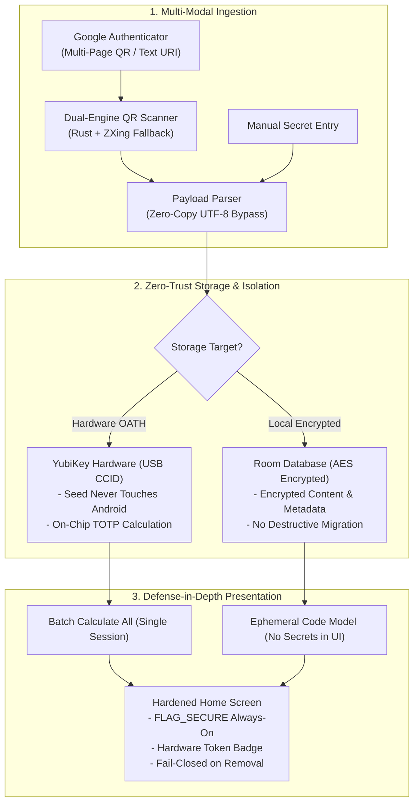

# Proton Authenticator +

[](https://www.gnu.org/licenses/gpl-3.0)
[](https://developer.android.com)
[](#security-overhaul--architectural-pillars)
[](#1-hardware-backed-authenticator-yubikey-oath)

**Proton Authenticator +** is a comprehensive security and privacy overhaul of the open-source Proton Authenticator for Android. It is engineered specifically for high-threat environments, security professionals, and zero-trust operational requirements where phone-resident plaintext seeds, unencrypted backups, and cloud-sync exposures represent unacceptable risk.

> [!IMPORTANT]
> This is an independent hardened distribution and is not affiliated with or published by Proton AG. The upstream project remains Proton Authenticator by Proton AG under the GNU General Public License v3.0.

---

## Security Overhaul & Architectural Pillars

Proton Authenticator + transforms the standard mobile authenticator model from a software-bound secret vault into a zero-trust, hardware-integrated credential manager.



### 1. Hardware-Backed Authenticator (YubiKey OATH)
Traditional authenticators store TOTP secrets locally in phone storage, decrypting them into process memory on demand where malware, forensic dumps, or memory scrapers can extract them. Proton Authenticator + integrates Yubico OATH via USB CCID:
- **True Seed Non-Exposure:** The TOTP secret is written directly to the YubiKey OATH applet during enrollment or migration. The secret is never stored in the Android Room database, flash memory, or Android system backups.
- **On-Chip Calculation:** TOTP codes are computed by the YubiKey microcontroller, not Android CPU cores.
- **Single-Session Batch Calculation (`INS_CALCULATE_ALL`):** All hardware-backed accounts are calculated in a single USB CCID session instead of opening redundant, slow, per-account sessions.
- **Touch-Sense Detection:** Detects touch-required credentials automatically to calculate the current code without prematurely firing a second touch prompt for the next period code.
- **Fail-Closed on Disconnect:** If the YubiKey is removed or locked, the interface immediately blanks the OTP codes (`------`) rather than leaving stale, valid tokens visible.
- **Hardware Slot Reclamation:** Deleting a hardware-backed entry deletes the credential from the physical YubiKey over USB CCID before removing the local entry. The key must be connected and the credential must be present; if deletion fails, the local entry is retained. Uninstalling the app or clearing its data does not erase credentials stored on the physical YubiKey.

### 2. Verified Migration & Cloud Deletion
- **Pre-Wipe Code Verification:** When selecting `Move to YubiKey` on an existing local account, the app writes the secret to the YubiKey, calculates the current code on both Android and the hardware key, and verifies that the outputs match before permanently erasing the local seed. If verification fails, the local entry is left completely intact.
- **Remote Cloud Copy Purge:** When moving a software entry to hardware, the app prompts to delete the copy stored in Proton Cloud (default: Yes). On the next synchronization pass, the cloud copy is purged from the remote server, and the local entry is tombstoned so stale cloud copies cannot resurrect the software seed.
- **Strict Cloud Air-Gapping:** Hardware-backed entries are permanently excluded from Proton Cloud synchronization (`SyncEntriesModelsUseCase`), preventing empty-secret or metadata leakage to external servers.

### 3. Zero-Footgun Export & Backup Protection
- **No Plaintext Exports:** The legacy "Export without password" and "Enable backup without password" actions have been completely excised.
- **Mandatory Password Encryption:** All vault exports and automated backups require user-provided password encryption.
- **Hardware Exclusion from Backups:** Because hardware-bound seeds cannot and should not be extracted from the YubiKey, export and backup routines automatically filter out YubiKey entries rather than failing or corrupting the backup archive. Remaining software entries are safely archived.

### 4. Flash & Memory Hardening
- **Metadata Encryption at Rest:** Account name, issuer, and notes for hardware-backed entries are encrypted at rest in `EntryEntity.encrypted_content` using AES encryption tags. Plaintext database columns are nullified to prevent OS-level forensic leakage from flash storage.
- **Ephemeral UI Presentation Models:** The home screen presentation model (`HomeMasterEntryModel`) retains only non-secret display metadata and the ephemeral 6/8-digit code, completely dropping decrypted secret strings and secret-bearing `otpauth://` URIs from long-lived memory structures.
- **No Destructive Database Migrations:** `fallbackToDestructiveMigration()` has been removed from Room configuration. Any schema migration discrepancy fails loudly instead of silently wiping the user's two-factor authentication database.
- **Always-On `FLAG_SECURE`:** Enforced throughout the application lifecycle to block Android screenshots, screen recording utilities, and task-switcher snapshots.

### 5. Complete Google Authenticator Import Overhaul
Migrating multi-token vaults from Google Authenticator is now completely seamless, fault-tolerant, and high-performance:
- **Instant Camera Payload Forwarding:** Bypasses redundant camera-frame PNG compression, disk writes, and secondary decoding passes by directly forwarding the ZXing-decoded `otpauth-migration://` payload as UTF-8 bytes.
- **Multi-Page QR Export Batch Ingestion:** Google Authenticator exports accounts in sequential QR codes ("1 of 3", "2 of 3") when vaults exceed 10 accounts. Proton Authenticator + processes multiple selected screenshots from the gallery in a single atomic batch pass, assigning sequential positions and persisting all accounts.
- **Text-File and Raw URI Imports:** Direct ingestion of `.txt` export files containing `otpauth-migration://offline?data=...` or standard `otpauth://` URIs without requiring QR image rendering.
- **Dual-Engine QR Decoder Fallback:** Seamlessly tries the native Rust QR engine first, falling back automatically to ZXing's `HybridBinarizer` and `GlobalHistogramBinarizer` on challenging, low-contrast, or screen-captured images.

---

## Feature Comparison Matrix

| Feature | Standard Authenticator | Proton Authenticator + |
| :--- | :---: | :---: |
| **YubiKey OATH Hardware Storage (USB CCID)** | ❌ No | ✅ **Full Support** |
| **On-Chip Hardware Code Calculation** | ❌ No | ✅ **Yes (`CALCULATE ALL`)** |
| **Touch-Required Hardware Token Detection** | ❌ No | ✅ **Yes** |
| **Pre-Wipe Verified Hardware Migration** | ❌ No | ✅ **Yes** |
| **Automated Proton Cloud Copy Deletion** | ❌ No | ✅ **Yes** |
| **Hardware Slot Reclamation on Deletion** | ❌ No | ✅ **Yes** |
| **Metadata Encryption at Rest for Hardware Tokens** | ❌ No | ✅ **Yes** |
| **Mandatory Password-Protected Exports & Backups** | ❌ Optional | ✅ **Enforced (No Plaintext)** |
| **Ephemeral Memory Model (No Decrypted Secrets in UI)** | ❌ Retained | ✅ **Zero Decrypted Secrets in UI** |
| **Destructive Database Fallback Prevention** | ❌ Silent Wipe | ✅ **Fail-Loud Protection** |
| **Always-On `FLAG_SECURE` (Anti-Screenshot/Recents)** | ⚠️ Partial | ✅ **Always Enforced** |
| **Google Authenticator Multi-Page Batch Import** | ❌ Single Only | ✅ **Multi-Selection Batch** |
| **Google Authenticator Direct Text/URI Import** | ❌ Images Only | ✅ **Direct `.txt` / URI Support** |
| **Dual-Engine QR Scanning Fallback (Rust + ZXing)** | ❌ Single Engine | ✅ **Dual Engine** |

---

## Application ID & Signing Architecture

This fork operates under an independent package namespace to avoid collision with upstream installations:

- **Base Package ID:** `com.swordintel.protonauthplus`
- **F-Droid Release Package ID:** `com.swordintel.protonauthplus.fdroid`

Android treats differing application IDs as distinct sandboxed applications. Installing Proton Authenticator + will not overwrite or replace the official Proton Authenticator app; you can run both simultaneously during migration.

---

## Building from Source

### Prerequisites
- JDK 17 or higher
- Android SDK with build-tools (API 35 / compileSdk 35)
- Git

### Debug Build
To compile and install the debug APK on a connected device or emulator:

```shell
./gradlew :app:installFdroidProdDebug --no-configuration-cache
```

### Verified Production Release (F-Droid Flavor)
To generate the signed, production-ready F-Droid release APK:

```shell
./scripts/verifyFdroidProdRelease.sh
```

The script automatically detects the local Android SDK, checks for required release signing configuration, builds the APK, verifies signature integrity, and displays the SHA-256 package fingerprints:

- **Output Artifact:** `app/build/outputs/apk/fdroidProd/release/app-fdroid-prod-release.apk`

---

## Technical Documentation & References

- [Implementation Details & Threat Model](file:///home/john/ProtonAuthPlus/docs/hardening-yubikey-oath.md): Comprehensive architectural analysis of YubiKey OATH integration, APDU commands, and memory safety.
- [Build, Install, and Release Guide](file:///home/john/ProtonAuthPlus/docs/public/BUILD.md): Step-by-step local building and release verification procedures.
- [Changelog](file:///home/john/ProtonAuthPlus/CHANGELOG.md): Complete chronological record of security fixes, features, and optimizations.
- [Project Improvement Roadmap](file:///home/john/ProtonAuthPlus/ROADMAP.md): Status record of all hardening phases.

---

## License

This project is licensed under the terms of the **GNU General Public License v3.0** (GPLv3). See the [LICENSE](file:///home/john/ProtonAuthPlus/LICENSE) file for complete license text. All upstream copyright notices from Proton AG remain intact.
