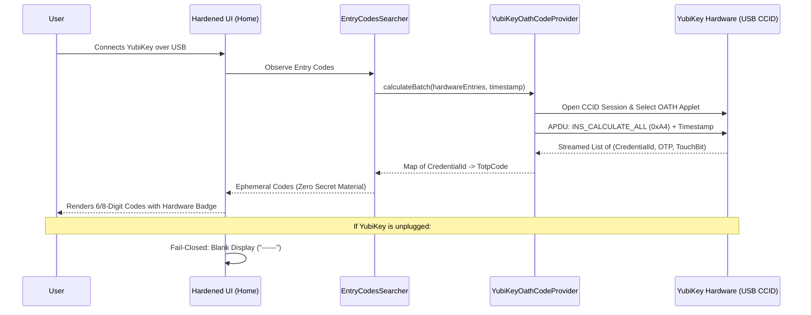
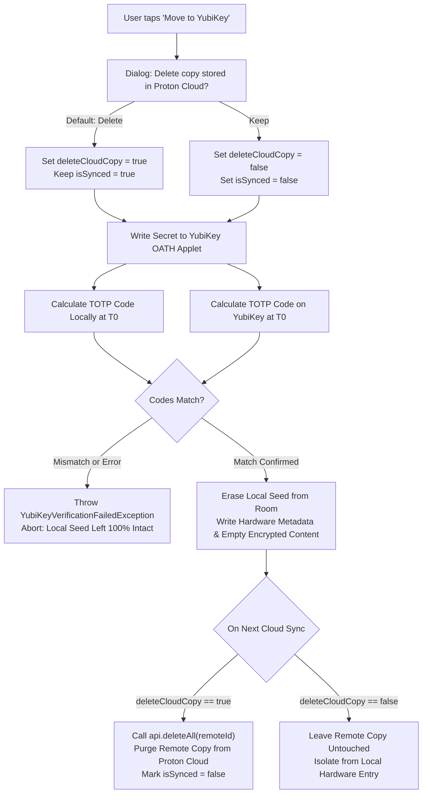
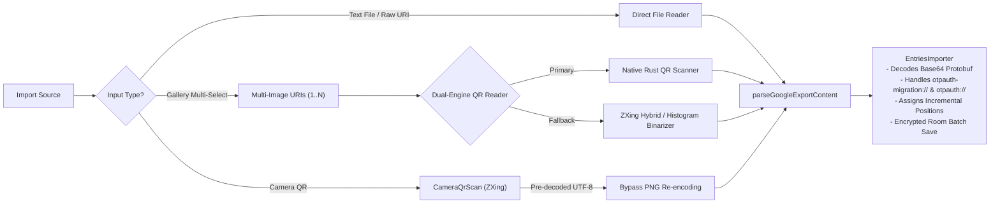

# Hardened Security Overhaul & YubiKey OATH Architecture

## Executive Summary

**Proton Authenticator +** represents a complete architectural overhaul of Proton Authenticator for Android, designed to eliminate the fundamental vulnerabilities inherent in software-bound mobile two-factor authenticators. In traditional authenticators, TOTP seed material resides permanently in phone flash storage and is routinely decrypted into process memory during code generation and UI binding. Under a compromised device threat model (e.g., memory dumping, forensic extraction, or malicious local processes), all two-factor protections fail simultaneously.

This fork eliminates these attack surfaces by establishing a hardware-rooted trust boundary using **YubiKey OATH over USB CCID**, enforcing strict cloud isolation, encrypting all flash metadata at rest, mandating password-protected exports, and rebuilding the import and QR-scanning pipelines for speed and resilience.

---

## Threat Model & Attack Surface Mitigation

| Attack Vector | Standard Authenticator Risk | Proton Authenticator + Mitigation |
| :--- | :--- | :--- |
| **Endpoint / Process Memory Scraping** | TOTP secrets decrypted and retained in long-lived UI and presentation models. | Hardware secrets never touch Android CPU or RAM; software entries use ephemeral presentation models with secrets stripped from UI state. |
| **Physical Extraction / Flash Dump** | Database metadata (account names, issuers) stored in plaintext columns. | All hardware metadata encrypted at rest in `EntryEntity.encrypted_content` via AES encryption tags. |
| **Silent Database Corruption** | Room's `fallbackToDestructiveMigration()` wipes the entire user vault if an unexpected schema mismatch occurs. | Destructive fallback removed entirely; schema mismatches fail loudly and prevent silent data loss. |
| **Malicious / Accidental Screen Capture** | Screenshots and task-switcher snapshots can capture valid TOTP codes and secrets. | Always-on `FLAG_SECURE` strictly enforced across the application lifecycle. |
| **Unencrypted Backup Footguns** | Users can inadvertently create unencrypted exports/backups containing raw seeds. | Plaintext export and backup pathways completely removed; AES password protection strictly enforced before generation. |
| **Cloud Secret Residency** | Migrated hardware tokens could retain lingering software copies on Proton Cloud. | Explicit cloud deletion prompt during migration with automated server-side purge on next sync; hardware entries air-gapped from cloud sync. |
| **Stale Cloud Resurrection** | An older cloud copy of an entry could overwrite or revert a migrated hardware token. | Local hardware entries are tombstoned on delete/migration; `EntriesSyncer` drops matching incoming cloud entries before computing sync actions. |
| **Faulty Hardware Enrollment / Brick** | Writing a secret to a hardware key and immediately wiping local storage without verification could lose access if the key failed or miscalculated. | Pre-wipe verification: local seed is only erased if a test TOTP calculation on the key matches the local engine's code for the exact same timestamp. |

---

## Architectural Deep Dive

### 1. Hardware OATH Protocol Integration (USB CCID)

The hardware backend interfaces with Yubico OATH applets via USB CCID:



#### Key Implementation Details:
- **Batch Code Calculation (`INS_CALCULATE_ALL`):** In `YubiKeyOathCodeProvider.calculateBatch`, all hardware entries are queried in a single APDU session (`0xA4`), avoiding the latency and USB reconnect overhead of individual queries.
- **Touch Detection (`TouchRequired`):** Credentials requiring physical touch are detected in the OATH applet response. The provider skips the "next period" speculative calculation for touch credentials, preventing confusing double-touch prompts.
- **Fail-Closed Presentation:** When the key is disconnected or busy, codes fail closed and render placeholder dashes (`------`), preventing the display of expired or stale tokens.
- **Hardware Slot Reclamation:** Deleting a hardware entry requires a connected YubiKey and a matching OATH credential. `EntryDeleter` deletes the physical credential before tombstoning the local entry; if the key is disconnected or the physical delete fails, deletion fails and the local entry remains. App uninstall/data clearing only affects phone-side state—it cannot erase OATH credentials stored on the key; those remain until explicitly removed from the key.

---

### 2. Verified Migration & Cloud Deletion (`Move to YubiKey`)

Migrating a software TOTP account to hardware requires rigorous verification and cloud hygiene:



---

### 3. Encrypted Metadata at Rest (Room Schema v7)

To prevent metadata leakage from flash storage dumps, hardware entries encrypt non-secret descriptive fields at rest:
- **Database Entity (`EntryEntity`):** Stores account `name`, `issuer`, and `note` inside `encrypted_content` via `EncryptionTag.EntryContent`.
- **Legacy Column Nullification:** Plaintext database columns (`hardware_name`, `hardware_issuer`, `hardware_note`) are left null on new writes, maintaining backward compatibility while eliminating forensic flash exposure.
- **Data Source Resilience:** `RoomEntriesPersistenceDataSource` handles missing credential IDs or corrupt rows gracefully by falling back to `LocalEncrypted` with logged warnings, preventing whole-database observation crashes.

---

### 4. Complete Multi-Modal Google Authenticator Import Engine

The import subsystem was overhauled to eliminate scanning bottlenecks and handle complex Google Authenticator exports:



#### Highlights:
1. **Zero-Copy Camera QR Forwarding:** Decoded QR values from the camera preview are immediately converted to UTF-8 byte arrays, bypassing the legacy pipeline that compressed the viewfinder frame to PNG and ran a secondary scan.
2. **Multi-Page Export Batch Processing:** When exporting large accounts (>10) from Google Authenticator, Google splits the vault across multiple sequential QR codes ("1 of 3", "2 of 3"). The user can select all screenshots simultaneously; `contentUris.flatMap { ... }` parses and consolidates all accounts atomically.
3. **Dual-Engine QR Decoding:** If native Rust decoding fails on distorted or low-contrast screenshots, `RustQrScanner` automatically triggers ZXing's `MultiFormatReader` with `HybridBinarizer` and `GlobalHistogramBinarizer`.
4. **Direct Text URI Ingestion:** Files containing raw `otpauth-migration://offline?data=...` or standard `otpauth://` URIs are parsed directly without image rendering.

---

## Security Verification & Build Integrity

### Unit Testing Coverage
The hardening changes are backed by automated unit and integration tests across all modified modules:
- `:business:entries:testDebugUnitTest`: Tests migration verification, hardware encryption, cloud sync filtering, deletion tombstoning, and complete Google Authenticator import scenarios.
- `:business:entry_codes:testDebugUnitTest`: Tests single-session batch calculation (`INS_CALCULATE_ALL`) and touch detection.
- `:shared:common:testDebugUnitTest`: Tests dual-engine QR decoding fallbacks.

### Release Verification Script
To produce a verified, signed F-Droid production build:
```shell
./scripts/verifyFdroidProdRelease.sh
```
The script validates Android SDK detection, enforces production release signing parameters, compiles the artifact without cached configurations, verifies v2/v3 signatures, and outputs the release SHA-256 fingerprints.
